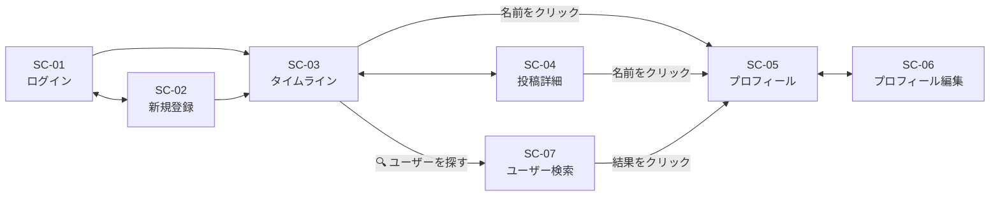
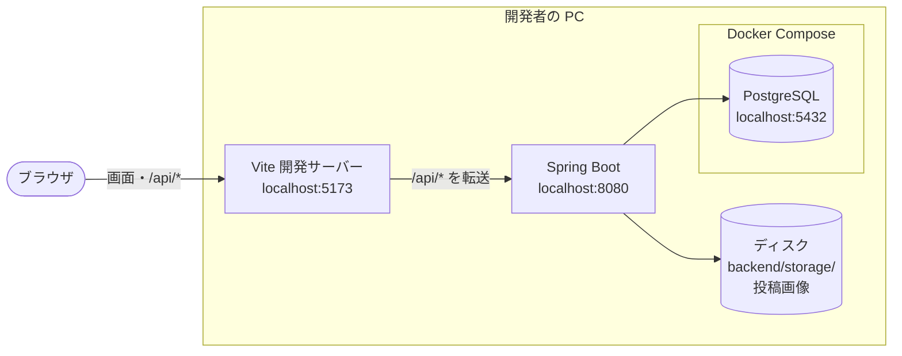
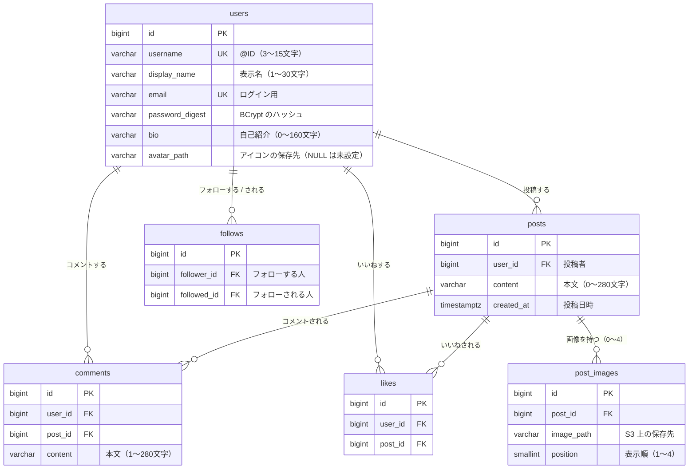
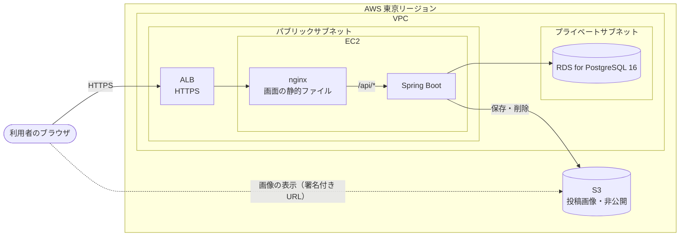

# RaiseTimeline

## 概要

X（旧 Twitter）のような、テキストを中心にしたタイムライン型の SNS です。ユーザー登録してログインし、280 文字までの本文と 4 枚までの画像を投稿できます。ほかのユーザーの投稿には、いいねとコメントを付けられます。

気になるユーザーは、名前で検索するか、投稿やコメントの名前からプロフィールを開いてフォローします。タイムラインの「フォロー中」タブには、フォローしているユーザーと自分の投稿だけが並びます。

Web アプリケーション開発の流れ（要件定義 → 設計 → 実装）を実践的に学ぶための学習用プロジェクトです。先行プロジェクトの [TaskManagement](https://github.com/KeiT0773/TASKMANAGEMENT)・[InquiryManagement](https://github.com/KeiT0773/InquiryManagement) で学んだ 3 層構成に加えて、ログイン（認証・認可）、多対多のリレーション（いいね・フォロー）、画像のアップロード、URL を持つ複数の画面を扱います。

> **現在の状況**：要件定義の段階です。文書だけがあり、アプリのコード（`backend/`・`frontend/`）はまだありません。以下の「起動手順」と「使い方」は、完成時の想定を要件定義書・機能別要件書に基づいて書いています。

**▶ アプリ操作動画**：完成後に掲載します。

**▶ 静的モック**：画面の流れは [mock/](mock/README.md) の `index.html` をブラウザで開くと試せます（HTML / CSS / JS のみ。ビルド・サーバー不要）。

## 起動手順

> 実装後に使えるようになります（`backend/`・`frontend/`・`compose.yaml` は実装開始時に作成します）。

必要なもの：[JDK 21](https://adoptium.net/)、[Node.js 24](https://nodejs.org/)、[Docker Desktop](https://www.docker.com/products/docker-desktop/)。PostgreSQL は PC に入れず、Docker のコンテナで動かします。

コマンドは Git Bash で、リポジトリのルートから実行します。

```bash
# 1. データベース（PostgreSQL）を起動する
docker compose up -d

# 2. バックエンド（Spring Boot）を起動する。テーブルは起動時に Flyway が作る
cd backend
./gradlew bootRun

# 3. フロントエンド（React + Vite）を起動する（別のターミナルで）
cd frontend
npm install   # 初回と、package.json が変わったときだけ
npm run dev
```

起動したら、ブラウザで次の URL を開きます。

| URL | 内容 |
| --- | --- |
| http://localhost:5173 | アプリの画面（未ログインならログイン画面） |
| http://localhost:8080/api/health | バックエンドの死活確認（`{"status":"ok"}` なら起動している） |

止めるときは、`npm run dev` と `./gradlew bootRun` のターミナルで `Ctrl + C` を押し、リポジトリのルートで `docker compose stop` を実行します。データは残ります。

ポートは Vite が 5173、Spring Boot が 8080、PostgreSQL が 5432 に固定です。使用中でも別のポートでは起動せず、使っているプロセスを止めてから起動し直してください。TaskManagement と同じポートのため、両方を同時には起動できません。

開発時、投稿画像は S3 ではなく `backend/storage/` に保存されます。

## 使い方

ログインしていないと、ログイン画面と新規登録画面以外は開けません。ほかのユーザーの新しい投稿やいいねは自動では画面に反映されないため、画面を再読み込みするか [さらに読み込む] で確認します。

### アカウントを作る・ログインする

1. ログイン画面の「新規登録」から、ユーザー名（@ID）・表示名・メールアドレス・パスワードを入力して登録します。登録するとそのままログインし、タイムラインが開きます。
2. 次回からはメールアドレスとパスワードでログインします。ログイン状態はブラウザを閉じても 14 日間保たれます。
3. ヘッダーの [ログアウト] でログアウトします。

ユーザー名は半角英数字と `_` で 3〜15 文字です。登録後は変更できません（大文字と小文字だけが違う名前は登録できません）。

### 投稿する

1. タイムラインの上にある入力欄に本文を書きます。残り文字数が表示されます（280 文字まで）。
2. 画像を付けるときは 🖼 を押してファイルを選びます。JPEG・PNG・GIF・WebP を 1 枚 5MB まで、4 枚まで付けられます。プレビューの [×] で外せます。
3. [投稿] を押します。本文か画像のどちらか一方があれば投稿できます。

画像の位置情報（EXIF）は、保存するときに取り除かれます。投稿は編集できません。

### タイムラインを読む

- 「すべて」タブには全ユーザーの投稿が、「フォロー中」タブにはフォローしているユーザーと自分の投稿が、新しい順に並びます。
- 20 件ずつ表示され、一番下の [さらに読み込む] で続きを表示します。
- 本文を押すと投稿詳細が開きます。画像を押すと拡大表示になり、← → で切り替え、`Esc` で閉じます。
- ♡ を押すといいねが付き、もう一度押すと外れます。件数はすぐに変わります。

### コメントする

投稿詳細の下にある入力欄に書いて [コメント] を押します（280 文字まで）。コメントは古い順に並びます。

### 削除する

自分の投稿・コメントにだけ [削除] が表示されます。確認ダイアログで「OK」を押すと削除されます。投稿を削除すると、その投稿のコメント・いいね・画像も一緒に消え、元に戻せません。

### フォローする相手を探す

フォローする相手は、次の 2 つの方法で見つけます。

| 方法 | 手順 |
| --- | --- |
| ユーザー検索から | ヘッダーの「🔍 ユーザーを探す」を開き、@ユーザー名か表示名の一部を入れて検索します（`@` は付けても付けなくても同じです）。結果の行の [フォローする] で、その場でフォローできます。検索欄が空のときは、まだフォローしていない人気のユーザーが「おすすめユーザー」として表示されます |
| 投稿・コメントから | タイムライン・投稿詳細・プロフィールで、投稿者やコメントした人の名前を押すと、その人のプロフィールが開きます。そこにある [フォローする] でフォローします |

[フォロー中] をもう一度押すとフォローを解除します（確認は表示されません）。自分自身はフォローできません。

### プロフィールを見る・編集する

- プロフィールには、アイコン・表示名・@ユーザー名・自己紹介・登録日・投稿数・フォロー数・フォロワー数と、その人の投稿の一覧が表示されます。相手が自分をフォローしていると「フォローされています」と表示されます。
- ヘッダーの自分の名前を押すと、自分のプロフィールが開きます。[プロフィールを編集] から、アイコン（JPEG・PNG・GIF・WebP、5MB まで）・表示名（30 文字まで）・自己紹介（160 文字まで）を変更できます。アイコンを設定していないときは、表示名の頭文字が丸く表示されます。

## 機能

| ID | 機能 | 内容 |
| --- | --- | --- |
| F-01 | 新規登録 | ユーザー名・表示名・メール・パスワードでアカウントを作り、そのままログインする |
| F-02 | ログイン | メールアドレスとパスワードでログインする |
| F-03 | ログアウト | ログイン状態を破棄してログイン画面へ戻る |
| F-04 | アクセス制御 | 未ログインのときはログイン画面へ移す |
| F-05 | タイムライン表示 | 「すべて」タブで全ユーザーの投稿を新しい順に表示する |
| F-06 | ページング | 20 件ずつ表示し、[さらに読み込む] で続きを表示する |
| F-07 | 件数表示 | 各投稿にいいね数・コメント数を表示する |
| F-08 | 投稿作成 | 280 文字までの本文を投稿する。画像が無いときは本文が必須 |
| F-09 | 投稿詳細表示 | 1 件の投稿とそのコメントを表示する |
| F-10 | 投稿削除 | 自分の投稿を、確認ダイアログを経て削除する。コメント・いいね・画像も消える |
| F-11 | コメント作成 | 投稿に 280 文字までのコメントを付ける |
| F-12 | コメント一覧表示 | コメントを古い順に表示する |
| F-13 | コメント削除 | 自分のコメントを削除する |
| F-14 | いいね / 取り消し | ♡ でいいねを付け外しする。件数はすぐに変わる |
| F-15 | 自分のいいね状態表示 | いいね済みの投稿はハートを塗りつぶして表示する |
| F-16 | プロフィール表示 | ユーザーのアイコン・情報・件数と投稿の一覧を表示する |
| F-17 | 画像添付・表示 | 投稿に画像を 4 枚まで付ける。押すと拡大表示する |
| F-18 | プロフィール編集 | 自分のアイコン・表示名・自己紹介を変更する |
| F-19 | フォロー / 解除 | プロフィールや検索結果のボタンでフォローを付け外しする |
| F-20 | フォロー数・フォロワー数表示 | プロフィールにフォロー数・フォロワー数を表示する |
| F-21 | タイムライン切り替え | 「すべて / フォロー中」のタブで切り替える |
| F-22 | ユーザー検索 | @ユーザー名・表示名の部分一致でユーザーを探す |
| F-23 | おすすめユーザー | 検索語が空のとき、まだフォローしていないユーザーをフォロワーの多い順に 10 人表示する |

インプレッション数・リポスト・通知・DM・投稿本文の検索・フォロー / フォロワーの一覧画面はありません。詳しい仕様は[機能一覧](docs/02_features.md)と[機能別要件書](docs/features/)を参照してください。

### 画面

| ID | 画面 | URL |
| --- | --- | --- |
| SC-01 | ログイン | `/login` |
| SC-02 | 新規登録 | `/signup` |
| SC-03 | タイムライン | `/`、`/?tab=following` |
| SC-04 | 投稿詳細 | `/posts/:id` |
| SC-05 | プロフィール | `/users/:username` |
| SC-06 | プロフィール編集 | `/settings/profile` |
| SC-07 | ユーザー検索 | `/search?q=<検索語>` |



画面ごとの構成は[画面設計](docs/03_screens.md)を参照してください。

## 技術構成

| 層 | 技術 | ディレクトリ |
| --- | --- | --- |
| フロントエンド | React 19 / TypeScript / Vite / React Router / CSS Modules | `frontend/`（作成予定） |
| バックエンド | Java 21 / Spring Boot（Spring Web・Spring Security・Spring Data JPA・Bean Validation）/ Flyway / Gradle | `backend/`（作成予定） |
| データベース | PostgreSQL 16 | `compose.yaml`（ローカル。作成予定） |
| 画像の保存 | Amazon S3（AWS SDK for Java 2.x）。開発時はローカルのディスク | — |
| テスト・検査 | フロントエンド：Vitest / React Testing Library / oxlint / Prettier<br>バックエンド：JUnit 5 / Spring Boot Test / Spring Security Test / Checkstyle | — |
| インフラ | 未決定（案：AWS の ALB + EC2 + RDS + S3 / Terraform） | — |

版数は雛形を作成した時点で確定します。選定の理由は[技術スタック](docs/05_tech_stack.md)を参照してください。

### ローカル環境の構成



ブラウザは画面も API も Vite の開発サーバー（5173）から受け取り、`/api/*` は Vite が Spring Boot へ転送します。画面と API が同じオリジンになるため、ログインの Cookie と CSRF の対策をそのまま使えます。

### API（案）

正式な定義は API 設計書（作成予定）で行います。

| メソッド | パス | 内容 |
| --- | --- | --- |
| POST | `/api/auth/signup` | ユーザー登録（そのままログイン） |
| POST | `/api/auth/login` | ログイン |
| POST | `/api/auth/logout` | ログアウト |
| GET | `/api/auth/me` | ログイン中のユーザーの情報 |
| GET | `/api/posts?tab=all\|following` | タイムライン（20 件） |
| POST | `/api/posts` | 投稿の作成（本文＋画像、`multipart/form-data`） |
| GET | `/api/posts/:id` | 投稿 1 件の取得 |
| DELETE | `/api/posts/:id` | 投稿の削除 |
| GET / POST | `/api/posts/:id/comments` | コメントの一覧・作成 |
| DELETE | `/api/comments/:id` | コメントの削除 |
| POST / DELETE | `/api/posts/:id/like` | いいね・いいねの取り消し |
| GET | `/api/users/:username` | プロフィール |
| GET | `/api/users/:username/posts` | プロフィールの投稿一覧 |
| PATCH | `/api/me/profile` | 自分のプロフィールの更新（アイコンを含む） |
| POST / DELETE | `/api/users/:username/follow` | フォロー・フォロー解除 |
| GET | `/api/users/search?q=` | ユーザー検索 |
| GET | `/api/users/recommended` | おすすめユーザー |

### データ構造



- いいねは `UNIQUE (user_id, post_id)`、フォローは `UNIQUE (follower_id, followed_id)` と `CHECK (follower_id <> followed_id)` で、重複と自分自身へのフォローを DB でも防ぎます。
- いいね数・コメント数・フォロー数は専用の列を持たず、集計で求めます。
- 画像ファイルは DB に入れず、ストレージ（S3）に保存して、DB には保存先のパスだけを持ちます。

テーブル定義と、タイムライン・検索の SQL は [ER図・テーブル定義](docs/04_er_diagram.md) を参照してください。

### リポジトリ構成

```text
RaiseTimeline/
├── .claude/          Claude Code の設定（settings.json・フック・スキル）
├── .github/          Issue・PR のテンプレート
├── docs/             要件定義書・設計書
│   └── features/     機能別要件書（8 本）
├── mock/             HTML / CSS / JS だけの静的モック（index.html を開くだけで動く）
├── backend/          Spring Boot アプリケーション（作成予定）
├── frontend/         React アプリケーション（作成予定）
├── compose.yaml      ローカル開発用の PostgreSQL（作成予定）
├── CLAUDE.md         Claude Code が従うルール
├── .editorconfig     エディタの共通設定
└── .gitattributes    改行コードを LF に統一
```

## インフラ（案）

本番環境をどこに置くかは、まだ決まっていません。決まっているのは「投稿画像の保存先に Amazon S3 を使う」ことだけです。AWS 上にサーバーを構築する場合は、次の構成を想定しています。



| サービス | 役割 |
| --- | --- |
| ALB | 入口。HTTPS で通信し、EC2 へ転送する |
| EC2 | nginx が画面の静的ファイルを返し、`/api/*` を Spring Boot へ転送する |
| RDS for PostgreSQL | データベース。EC2 からの接続だけを受け付ける |
| S3 | 投稿画像。非公開にし、期限つきの署名付き URL で表示する |

HTTPS の実現方法（独自ドメインを取るか、ALB の前に CloudFront を置くか）、EC2 の台数、費用などは保留中です。詳しくは[インフラ構成（案）](docs/06_infra_design.md)を参照してください。

## 文書

| 文書 | 内容 |
| --- | --- |
| [要件定義書](docs/01_requirements.md) | 背景・目的、システム構成、スコープ、業務ルール、非機能要件、入力制約、決定事項、受け入れ基準（上位文書） |
| [機能一覧](docs/02_features.md) | 機能 ID（F-01〜F-23）の一覧、権限マトリクス、画面の URL と API の一覧 |
| [機能別要件書](docs/features/) | 機能の大分類ごとの詳しい振る舞い・入力制約・エラー・受け入れ基準 |
| [画面設計](docs/03_screens.md) | 画面一覧（SC-01〜SC-07）、画面遷移図、ワイヤーフレーム |
| [ER図・テーブル定義](docs/04_er_diagram.md) | ER 図、テーブル定義、一覧・件数・検索の取得方法 |
| [技術スタック](docs/05_tech_stack.md) | 各層の技術の選定と理由、開発環境、ポート |
| [インフラ構成（案）](docs/06_infra_design.md) | AWS 上に構築する場合の構成案と保留事項 |
| [開発フロー](docs/07_development_workflow.md) | Issue・ブランチ・PR の運用ルール |
| API 設計書・データ設計書・フロントエンド設計書 | 作成予定（基本設計） |

### 機能別要件書

| 大分類 | 文書 | 機能 ID |
| --- | --- | --- |
| ログイン（認証） | [auth.md](docs/features/auth.md) | F-01〜F-04 |
| タイムライン | [timeline.md](docs/features/timeline.md) | F-05〜F-07, F-21 |
| 投稿（画像添付を含む） | [post.md](docs/features/post.md) | F-08〜F-10, F-17 |
| コメント | [comment.md](docs/features/comment.md) | F-11〜F-13 |
| いいね | [like.md](docs/features/like.md) | F-14, F-15 |
| フォロー / フォロワー | [follow.md](docs/features/follow.md) | F-19, F-20 |
| プロフィール | [profile.md](docs/features/profile.md) | F-16, F-18 |
| ユーザー検索 | [user-search.md](docs/features/user-search.md) | F-22, F-23 |

## 開発の進め方

変更は Issue → ブランチ → Pull Request の順で行い、`main` へは squash マージで反映します。`main` への直接 push は GitHub の Ruleset で禁止しています。ブランチ名は `<種別>/<Issue番号>-<英小文字の要約>`（例：`feat/12-post-create`）です。詳しくは[開発フロー](docs/07_development_workflow.md)を参照してください。

Claude Code で開発するときのルールは [CLAUDE.md](CLAUDE.md) にあります。先行プロジェクトから引き継いだ次の設定が入っています。

| ファイル | 内容 |
| --- | --- |
| [.claude/settings.json](.claude/settings.json) | 破壊的な操作（`rm`、`git reset --hard`、force push、GitHub リポジトリの削除など）の禁止、AWS を変える操作の確認、フックの登録 |
| [.claude/hooks/guard-main-branch.ps1](.claude/hooks/guard-main-branch.ps1) | `main` 上での commit / push / merge と、命名規則に合わないブランチ名を拒否する |
| [.claude/hooks/guard-ports.ps1](.claude/hooks/guard-ports.ps1) | サーバーを既定以外のポートで起動するコマンドを拒否する |
| [.claude/skills/start-dev-servers](.claude/skills/start-dev-servers/SKILL.md) | 開発サーバーの起動手順 |
| [.claude/skills/quality-review](.claude/skills/quality-review/SKILL.md) | 品質チェック・レビューの手順 |
