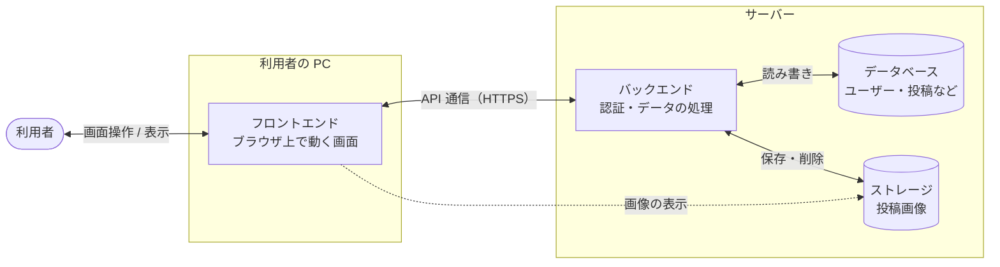

# RaiseTimeline 要件定義書

## 1. 文書情報

| 項目 | 内容 |
| --- | --- |
| 文書名 | RaiseTimeline 要件定義書 |
| 版数 | 2.1 |
| 作成日 | 2026-11-14 |
| 最終更新日 | 2026-11-22 |
| ステータス | 作成中 |
| 関連文書 | [機能一覧](02_features.md)、[機能別要件書](features/)、[画面設計](03_screens.md)、[ER図・テーブル定義](04_er_diagram.md)、[技術スタック](05_tech_stack.md)、[インフラ構成（案）](06_infra_design.md)、[開発フロー](07_development_workflow.md) |

本書は、本システムの背景・目的・スコープ・全体方針を定める上位文書である。機能・画面・データの詳細は関連文書に定義する（「8. 詳細要件」参照）。文書の構成は、先行プロジェクトの TaskManagement・InquiryManagement の要件定義書にならう。

### 1.1 変更履歴

| 版数 | 日付 | 変更内容 |
| --- | --- | --- |
| 1.0 | 2026-11-14 | 初版作成（ログイン・タイムライン・投稿・コメント・いいね） |
| 1.1 | 2026-11-14 | フォロー・プロフィール機能を MVP に追加 |
| 1.2 | 2026-11-14 | 投稿・コメントの上限を 280 文字に変更。画像添付（最大 4 枚）を MVP に追加 |
| 2.0 | 2026-11-15 | 上位文書として再構成（文書情報、システム構成、用語定義、利用シナリオ、制約事項、決定事項、受け入れ基準を追加）。ユーザー検索を対象に追加。技術スタックを決定 |
| 2.1 | 2026-11-22 | ユーザーのアイコン画像を MVP に追加（3. 用語定義、4. X との違い、5.2 対象外、6.2 利用シナリオ、9. 非機能要件、10. 入力制約、12. 決定事項 No.6 の変更と No.15） |

---

## 2. プロジェクト概要

### 2.1 背景・目的

X（旧 Twitter）のような、テキストを中心にしたタイムライン形式の SNS を、学習を目的に作る。先行プロジェクト（TaskManagement・InquiryManagement）で学んだ「3 層構成の Web アプリ」に加えて、次のことを一通り実装して学ぶ。

- 利用者の登録・ログイン（認証）と、他人のデータを操作させない仕組み（認可）
- 1 対多・多対多（いいね、フォロー＝自己参照）のリレーションと、件数の集計
- ファイル（画像）のアップロードと、DB の外のストレージ（S3）への保存
- URL を持つ複数の画面の切り替え

| 項目 | 内容 |
| --- | --- |
| アプリ名 | RaiseTimeline（仮） |
| 種別 | テキストを中心にしたタイムライン形式の SNS 風 Web アプリ |
| 想定利用者 | 受講生・個人（ただし **複数ユーザーが同時に使う** 前提で設計する） |
| 参考サービス | X（旧 Twitter） |

### 2.2 システム構成

本システムは、先行プロジェクトと同じく 3 層で構成し、投稿画像だけはファイルのストレージに保存する。

| 層 | 役割 | 技術 |
| --- | --- | --- |
| フロントエンド | 利用者が操作する画面。入力の受け付け、表示 | React + Vite（[技術スタック](05_tech_stack.md) 4.） |
| バックエンド | 認証、入力の検証、権限の確認、DB・ストレージの読み書き | Java + Spring Boot（同 3.） |
| データベース | ユーザー・投稿・コメント・いいね・フォロー・画像の保存先パスを保管する | PostgreSQL（同 5.） |
| ストレージ | 投稿画像のファイルを保管する | 本番は Amazon S3、開発時はローカルのディスク（同 3.） |

本番の配置先（AWS 上にサーバーを構築するか）は未決定。構築する場合の案を[インフラ構成（案）](06_infra_design.md)に示す。

---

## 3. 用語定義

| 用語 | 定義 |
| --- | --- |
| ユーザー | 本システムにアカウントを登録した利用者 |
| ユーザー名（@ID） | ユーザーを一意に表す英数字の名前。画面では先頭に `@` を付けて表示する。変更できない |
| 表示名 | 画面に表示する名前。日本語可。重複してよく、変更できる |
| 投稿 | ユーザーが書いた本文（280 文字まで）と画像（4 枚まで）の 1 件 |
| タイムライン | 投稿を新しい順に並べた一覧。「すべて」と「フォロー中」の 2 種類 |
| コメント | 投稿に付ける返信。テキストのみ |
| いいね | 投稿への好意を表す印。1 ユーザーにつき 1 投稿 1 回 |
| フォロー | 他のユーザーの投稿を「フォロー中」タイムラインで追いかけるための登録。承認は不要 |
| フォロワー | そのユーザーをフォローしているユーザー |
| プロフィール | ユーザーごとのページ。アイコン・表示名・自己紹介・件数・投稿一覧を表示する |
| アイコン | ユーザーを表す丸い画像。本人がプロフィール編集で設定する。未設定のときは表示名の頭文字を表示する |
| ユーザー検索 | @ユーザー名・表示名でユーザーを探す機能 |
| おすすめユーザー | ユーザー検索の画面で、検索語が空のときに表示する、まだフォローしていないユーザー |

---

## 4. X（旧 Twitter）との違い

| 機能 | X | 本アプリ |
| --- | --- | --- |
| テキスト投稿 | あり（280 文字 ※無料プラン） | **あり（280 文字）** |
| 画像添付 | あり（最大 4 枚） | **あり（最大 4 枚。動画・GIF アニメの再生なし）** |
| タイムライン | あり（フォロー中 / おすすめ） | **あり（「すべて」= 全ユーザー /「フォロー中」= フォロー中のユーザー＋自分 の投稿を新しい順に表示）** |
| いいね（件数表示） | あり | **あり** |
| コメント（リプライ・件数表示） | あり | **あり** |
| インプレッション数の表示 | あり | **なし** |
| リポスト（リツイート）・引用 | あり | **なし** |
| フォロー / フォロワー | あり | **あり（フォロー・解除、フォロー数 / フォロワー数の表示）** |
| フォロー / フォロワー一覧 | あり | なし（拡張候補） |
| プロフィール | あり（アイコン・ヘッダー画像など） | **あり（アイコン・表示名・自己紹介。ヘッダー画像なし）** |
| ユーザー検索 | あり | **あり（@ユーザー名・表示名の部分一致。おすすめユーザーの表示）** |
| 投稿の検索・ハッシュタグ | あり | なし |
| DM・通知 | あり | なし |

---

## 5. スコープ

### 5.1 対象機能（MVP）

1. ログイン機能（新規登録・ログイン・ログアウト）
2. タイムライン機能（「すべて / フォロー中」タブ切り替え）
3. 投稿機能（テキスト・画像添付）
4. コメント機能
5. いいね機能
6. フォロー機能（フォロー・解除、フォロー数 / フォロワー数の表示）
7. プロフィール機能（プロフィール表示・プロフィール編集）
8. ユーザー検索機能（キーワード検索・おすすめユーザー）

機能 ID の一覧は[機能一覧](02_features.md)、各機能の詳細は[機能別要件書](features/)を参照。

### 5.2 対象外（MVP では作らない）

- インプレッション数（閲覧数）の計測・表示
- リポスト / 引用投稿
- フォロー / フォロワーの一覧画面（件数の表示のみ行う）
- 鍵アカウント（フォロー承認制）、ブロック・ミュート
- プロフィールのヘッダー画像、ユーザー名（@ID）・メールアドレスの変更（アイコンは対象。決定事項 No.15）
- 動画の投稿、コメントへの画像添付、投稿後の画像の差し替え・追加
- 投稿本文の検索、ハッシュタグ、検索履歴
- 通知、DM
- 投稿・コメントの編集（削除のみ可能）
- コメントへの返信（スレッドの入れ子）、コメントへのいいね
- パスワードリセット、メール認証、SNS ログイン、退会

### 5.3 拡張候補（MVP 完成後）

| 優先度 | 機能 | 備考 |
| --- | --- | --- |
| 中 | 退会 | 退会したユーザーの投稿・フォロー関係の扱いを決める必要がある |
| 低 | フォロー / フォロワー一覧画面 | `/users/:username/following`・`/followers` でユーザー一覧を表示 |
| 低 | 投稿本文の検索 | ユーザー検索の画面にタブを足す形を想定 |
| 低 | 無限スクロール | 「さらに読み込む」からの置き換え |

---

## 6. 想定利用者・利用シーン

### 6.1 想定利用者

| 項目 | 内容 |
| --- | --- |
| 想定利用者 | 受講生・個人。動作確認のために、複数のアカウントを作って同時に使う |
| 想定端末 | Windows 11 の PC のブラウザ（Google Chrome・Microsoft Edge の最新版）。スマートフォンの幅でも崩れない表示が望ましい |
| 同時利用 | 複数のユーザーが同時にログインして操作する。他のユーザーの新しい投稿は、画面を開き直すか [さらに読み込む] で反映される（リアルタイムの自動更新はしない） |
| 想定データ量 | ユーザー 100 人、投稿 10,000 件、1 投稿あたりのコメント 100 件程度 |

### 6.2 利用シナリオ

| 時点 | 利用者の行動 | システムの動き | 画面 | 関連機能 |
| --- | --- | --- | --- | --- |
| 初回 | アカウントを作る | 登録してそのままログイン状態になり、タイムラインが表示される | SC-02 → SC-03 | F-01 |
| 〃 | 「🔍 ユーザーを探す」を開き、知り合いの @ユーザー名で検索してフォローする | 検索結果の行がその場で [フォロー中] になる。検索欄が空のときはおすすめユーザーが出る | SC-07 | F-22, F-23, F-19 |
| 日常 | タイムラインの「フォロー中」タブで、フォローしている人の投稿を読む | フォロー中のユーザーと自分の投稿が新しい順に出る | SC-03 | F-21 |
| 〃 | 画像を 2 枚付けて投稿する | 先頭に自分の投稿が出て、画像が左右 2 分割で表示される | SC-03 | F-08, F-17 |
| 〃 | 気になる投稿に ♡ を押し、投稿を開いてコメントする | 件数がすぐに更新される | SC-03, SC-04 | F-14, F-11 |
| 〃 | 「すべて」タブで見かけた投稿や、コメント欄の知らない人の名前をクリックし、プロフィールを見てフォローする | プロフィールが開き、[フォローする] でフォローできる | SC-03/SC-04 → SC-05 | F-16, F-19 |
| 〃 | 自分のプロフィールを開き、アイコンを設定して自己紹介を書く | 編集画面で保存すると、プロフィールと自分の投稿・コメントのアイコンに反映される | SC-05 → SC-06 | F-18 |
| 〃 | 誤った投稿を削除する | 確認ダイアログの後に削除され、コメント・いいね・画像も消える | SC-03 | F-10 |

---

## 7. 業務ルール（共通の前提）

各機能に固有のルールは機能別要件書に定める。ここには機能をまたぐ共通のルールを記す。

- 投稿・コメント・いいね・フォロー・ユーザー検索は **ログインユーザーのみ** が行える。未ログインの利用者は、ログイン画面と新規登録画面以外を見られない。
- 他ユーザーの投稿に対して、いいね・コメントができる（自分の投稿にも可）。
- いいね・フォローは 1 回まで。もう一度押すと取り消し（トグル）。自分自身はフォローできない。
- 各投稿には **いいね数** と **コメント数** を表示する。
- 投稿・コメントの削除は **作成者本人のみ** が行える。プロフィールの編集は **本人のみ** が行える。
- 投稿には画像を **最大 4 枚** 添付できる。本文か画像の **どちらか一方があれば投稿できる**。
- 投稿を削除すると、その投稿に紐づくコメント・いいね・添付画像（DB の行と画像ファイルの両方）も削除される。
- 「フォロー中」タイムラインには、フォローしているユーザーの投稿と **自分の投稿** を表示する。
- 表示名・@ユーザー名は、どの画面でもクリックするとそのユーザーのプロフィールへ移る。プロフィールとユーザー検索の結果からフォローできる（[follow.md](features/follow.md) 2.1）。

---

## 8. 詳細要件

| 文書 | 内容 | 定義する ID |
| --- | --- | --- |
| [機能一覧](02_features.md) | 機能 ID の一覧、権限マトリクス、画面の URL と API の一覧 | F-01〜F-23 |
| [機能別要件書](features/) | 大分類ごとの詳細な振る舞い・入力制約・エラー・受け入れ基準（8 本） | F-01〜F-23 |
| [画面設計](03_screens.md) | 画面一覧、画面遷移図、ワイヤーフレーム | SC-01〜SC-07 |
| [ER図・テーブル定義](04_er_diagram.md) | ER図、テーブル定義、件数・検索の取得方法 | ― |
| [技術スタック](05_tech_stack.md) | 各層の技術の選定と理由 | ― |
| [インフラ構成（案）](06_infra_design.md) | 本番の構成案と保留事項 | ― |

---

## 9. 非機能要件

| 分類 | 要件 |
| --- | --- |
| セキュリティ | パスワードはハッシュ化（BCrypt）して保存する。平文保存は禁止 |
| セキュリティ | CSRF 対策、XSS 対策（投稿本文・コメント・自己紹介は必ずエスケープして表示）、SQL インジェクション対策（プレースホルダ / ORM を使う。LIKE 検索のワイルドカードもエスケープする） |
| セキュリティ | 他人の投稿・コメントを削除できないよう、サーバー側で権限を確認する（画面でボタンを隠すだけにしない） |
| セキュリティ | プロフィールの更新は URL にユーザー ID を含めず、常にログインユーザー自身の行だけを更新する |
| セキュリティ | 画像（投稿画像・アイコン）のアップロードは拡張子ではなくファイルの中身で形式を確かめる。保存するファイル名はランダムな名前に付け替える。位置情報などの EXIF は削除して保存する |
| 認証 | セッション（Cookie）方式。ログイン状態はブラウザを閉じても 14 日間保持してよい |
| 性能 | タイムライン（すべて / フォロー中）・プロフィールの投稿一覧・ユーザー検索は 1 回 20 件の表示とし、[さらに読み込む] で続きを表示する |
| 性能 | 一覧の表示で N+1 問題を起こさない（いいね数・コメント数・いいね済みか・画像・フォロー済みかを 1 ページ分まとめて取得する） |
| 性能 | 想定データ量（6.1）で、タイムラインの 1 ページ分の API が 1 秒以内に応答する |
| 性能 | 一覧では縮小した画像を表示し、クリック時に元のサイズで表示する。画像は遅延読み込みする |
| データ整合性 | いいね・フォローの重複は DB の一意制約でも防ぐ。自分自身へのフォローは DB の CHECK 制約でも防ぐ |
| 保存先 | 画像ファイルは DB には保存せず、ストレージ（本番は S3、開発時はローカルのディスク）に保存し、DB には保存先のパスだけを持つ |
| 表示 | 日時は一覧・コメントでは相対表示（「3分前」「2時間前」、1 日以上前は日付）、投稿詳細では絶対表示（`YYYY/MM/DD HH:mm`）。日本時間で表示する |
| 対応端末 | Google Chrome・Microsoft Edge の最新版（PC）。スマートフォンの幅でも崩れないレスポンシブ表示が望ましい |
| 通信の保護 | 本番では、ブラウザとサーバーの間の通信を HTTPS で暗号化する |

---

## 10. 入力制約

各機能の文脈での扱い（エラーの文言など）は機能別要件書に定める。

| 項目 | 制約 | 定める要件書 |
| --- | --- | --- |
| ユーザー名（@ID） | 必須、半角英数字とアンダースコア、3〜15 文字、大文字と小文字を区別せず一意。変更不可 | [auth](features/auth.md) |
| 表示名 | 必須、1〜30 文字（空白のみは不可）。プロフィール編集で変更可 | [auth](features/auth.md)、[profile](features/profile.md) |
| 自己紹介 | 任意、0〜160 文字。改行可 | [profile](features/profile.md) |
| アイコン | 任意、1 枚。JPEG / PNG / GIF（静止画として表示）/ WebP、5MB 以下。保存時に正方形に切り抜いて縮小する | [profile](features/profile.md) |
| メールアドレス | 必須、メール形式、一意 | [auth](features/auth.md) |
| パスワード | 必須、8〜72 文字 | [auth](features/auth.md) |
| 投稿本文 | 0〜280 文字。画像が無い場合は必須（空白のみは不可） | [post](features/post.md) |
| 投稿画像 | 任意、1 投稿 0〜4 枚。JPEG / PNG / GIF（静止画として表示）/ WebP、1 枚 5MB 以下 | [post](features/post.md) |
| コメント本文 | 必須、1〜280 文字（空白のみは不可） | [comment](features/comment.md) |
| 検索語 | 前後の空白と先頭の `@` を除いて 1〜50 文字 | [user-search](features/user-search.md) |

文字数はすべて前後の空白を除いてから判定する（本文の途中の改行・空白は数える）。

---

## 11. 制約事項

- 他のユーザーの操作（新しい投稿、いいね）は、画面に自動では反映されない。画面を開き直すか [さらに読み込む] で反映する。
- 本番の配置先は未決定（[インフラ構成（案）](06_infra_design.md)）。決まるまではローカル環境でだけ動かす。
- 投稿・コメント・フォローの取り消し（アンドゥ）はできない。削除は確認ダイアログを経て確定する。
- バックアップ・データの書き出しは本バージョンでは提供しない。

---

## 12. 決定事項

| No | 決定内容 | 関連 | 決定日 |
| --- | --- | --- | --- |
| 1 | インプレッション数の表示とリポスト・引用は作らない | 4, 5.2 | 2026-11-14 |
| 2 | 投稿・コメントの削除は作成者本人だけが行える。編集はできない | 7, F-10, F-13 | 2026-11-14 |
| 3 | いいね数・コメント数は専用の列を持たず、集計で求める（重くなったらカウンターキャッシュに切り替える） | [04](04_er_diagram.md) 3. | 2026-11-14 |
| 4 | フォロー・プロフィールを MVP に含める。タイムラインは「すべて / フォロー中」のタブで切り替え、「フォロー中」には自分の投稿も含める | F-16〜F-21 | 2026-11-14 |
| 5 | フォロー / フォロワーの一覧画面は作らず、件数の表示だけにする | F-20 | 2026-11-14 |
| 6 | プロフィールで編集できるのはアイコン・表示名・自己紹介だけ。ユーザー名・メールアドレスは変更できない（アイコンは 2026-11-22 に追加。No.15） | F-18 | 2026-11-14 |
| 7 | 投稿・コメントの上限は 280 文字とする | F-08, F-11 | 2026-11-14 |
| 8 | 投稿に画像を最大 4 枚添付できる。画像だけの投稿も可。コメントには画像を付けられない | F-17 | 2026-11-14 |
| 9 | 画像の保存先は Amazon S3 とする（開発時はローカルのディスク） | 2.2 | 2026-11-15 |
| 10 | フォローする相手の見つけ方は (1) ユーザー検索と、(2) 投稿・コメントの名前をクリックしてプロフィールから、の 2 経路とする | [follow](features/follow.md) 2.1 | 2026-11-15 |
| 11 | ユーザー検索は @ユーザー名と表示名の部分一致（大文字と小文字を区別しない）とし、検索語が空のときはおすすめユーザーを表示する。投稿本文の検索は作らない | F-22, F-23 | 2026-11-15 |
| 12 | 技術スタックは React（Vite）+ Spring Boot + PostgreSQL とする（TaskManagement と同じ） | [05](05_tech_stack.md) | 2026-11-15 |
| 13 | 機能の詳細は、機能の大分類ごとの機能別要件書（features/）に分けて定める。機能一覧は索引とする | 8 | 2026-11-15 |
| 14 | AWS 上にサーバーを構築するかは未決定。構築する場合は ALB + EC2 + RDS の構成を想定する | [06](06_infra_design.md) | 2026-11-15 |
| 15 | ユーザーのアイコン画像を MVP に含める。本人がプロフィール編集で設定・削除でき、未設定のときは表示名の頭文字を表示する。ヘッダー画像は作らない | F-16, F-18 | 2026-11-22 |

---

## 13. 受け入れ基準

機能ごとの受け入れ基準は、各機能別要件書の「受け入れ基準」に定める。すべての機能別要件書の受け入れ基準と、次の非機能要件の基準をすべて満たした時点で、本システムは完成とみなす。

| 対象 | 確認方法 | 合格条件 |
| --- | --- | --- |
| セキュリティ | 2 つのアカウント A・B を作り、B でログインした状態で A の投稿・コメントの削除 API、プロフィール更新 API を直接呼ぶ | どれも拒否され、A のデータは変わらない |
| セキュリティ | 投稿・コメント・自己紹介・表示名に `` を入れて表示する | 文字として表示され、スクリプトは実行されない |
| セキュリティ | DB の users を確認する | パスワードが平文で保存されていない |
| 性能 | 想定データ量（ユーザー 100 人・投稿 10,000 件）を入れてタイムラインを開く | 1 ページ分の API が 1 秒以内に応答する。SQL の発行回数が投稿の件数に比例して増えない |
| 同時利用 | 2 つのブラウザで別々のユーザーとしてログインし、同時に投稿・いいね・フォローをする | どちらの操作も失われず、再読み込みすると両方の結果が反映されている |
| 対応端末 | Chrome と Edge で全画面を開く。ブラウザの幅をスマートフォン程度（375px）に狭める | どちらのブラウザでも同じように動き、狭い幅でも横にはみ出さない |
