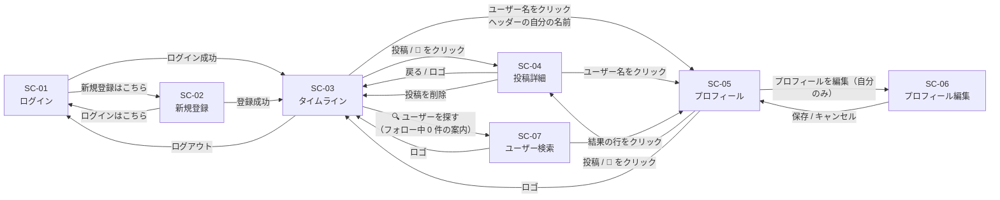

# RaiseTimeline 画面設計

## 0. 文書情報

| 項目 | 内容 |
| --- | --- |
| 文書名 | RaiseTimeline 画面設計 |
| 版数 | 2.1 |
| 作成日 | 2026-11-14 |
| 最終更新日 | 2026-11-22 |
| ステータス | 作成中 |
| 上位文書 | [要件定義書](01_requirements.md) |
| 関連文書 | [機能一覧](02_features.md)、[機能別要件書](features/) |

本書は、画面の一覧・画面遷移・ワイヤーフレーム（画面の骨組み）を定める。各画面で動く機能の詳しい振る舞い・エラーの文言は、機能別要件書を正とする。

### 0.1 変更履歴

| 版数 | 日付 | 変更内容 |
| --- | --- | --- |
| 1.0 | 2026-11-14 | 初版作成（SC-01〜SC-05） |
| 1.1 | 2026-11-14 | SC-05 を MVP に変更、SC-06 プロフィール編集を追加。タイムラインのタブを追加 |
| 1.2 | 2026-11-14 | 280 文字への変更、画像添付・画像ビューアーを追加 |
| 2.0 | 2026-11-15 | 文書情報を追加。SC-07 ユーザー検索画面と共通ヘッダーの節を追加。名前をクリックしたときの反応範囲を共通 UI ルールに追加 |
| 2.1 | 2026-11-22 | アイコンを共通ヘッダー・SC-03〜SC-07 のワイヤーフレームに追加。SC-06 にアイコンの設定欄を追加。名前をクリックしたときの反応範囲にアイコンを追加 |

## 1. 画面一覧

| ID | 画面名 | URL | ログイン要否 | 主な機能 | 優先度 |
| --- | --- | --- | --- | --- | --- |
| SC-01 | ログイン画面 | `/login` | 不要 | F-02 | MVP |
| SC-02 | 新規登録画面 | `/signup` | 不要 | F-01 | MVP |
| SC-03 | タイムライン画面 | `/`、`/?tab=following` | 必要 | F-05〜F-08, F-10, F-14, F-15, F-17, F-21 | MVP |
| SC-04 | 投稿詳細画面 | `/posts/:id` | 必要 | F-09〜F-15, F-17 | MVP |
| SC-05 | プロフィール画面 | `/users/:username` | 必要 | F-06, F-07, F-10, F-14〜F-17, F-19, F-20 | MVP |
| SC-06 | プロフィール編集画面 | `/settings/profile` | 必要 | F-18 | MVP |
| SC-07 | ユーザー検索画面 | `/search`、`/search?q=<検索語>` | 必要 | F-19, F-22, F-23 | MVP |

※ SC-03〜SC-07 には共通ヘッダー（3. 共通ヘッダー）を表示する。

## 2. 画面遷移図



- 共通ヘッダー（ロゴ・自分の名前・🔍 ユーザーを探す・ログアウト）は SC-03〜SC-07 のどの画面からも使える。図では TL からの線だけを描き、他の画面からの同じ線は省略している。
- フォローする相手を見つける経路は 2 つ：**SC-07 の検索結果から**、または **SC-03・SC-04・SC-05 の名前のクリック → SC-05 から**（[follow.md](features/follow.md) 2.1）。

## 3. ワイヤーフレーム

### 共通ヘッダー

```
┌──────────────────────────────────────────────────────────────┐
│ RaiseTimeline   🔍 ユーザーを探す   (山) 山田太郎 @taro [ログアウト] │
└──────────────────────────────────────────────────────────────┘
```

`(山)` はアイコン（28px の丸）。以下のワイヤーフレームでも `(頭文字)` でアイコンを表す。画像を設定していないユーザーは、表示名の頭文字を色付きの丸の中に表示する（[profile.md](features/profile.md) 3.）。

| 要素 | 動作 |
| --- | --- |
| RaiseTimeline（ロゴ） | SC-03（「すべて」タブ）へ |
| 🔍 ユーザーを探す | SC-07 へ（検索欄が空の状態。おすすめユーザーを表示） |
| 自分のアイコン・表示名・@ユーザー名 | 自分のプロフィール（SC-05）へ |
| [ログアウト] | 確認なしでログアウトし、SC-01 へ |

以下のワイヤーフレームでは、共通ヘッダーを 1 行に省略して描く。

### SC-01 ログイン画面

```
┌──────────────────────────────────────┐
│              RaiseTimeline           │
│                                      │
│   ┌──────────────────────────────┐   │
│   │ メールアドレス                 │   │
│   └──────────────────────────────┘   │
│   ┌──────────────────────────────┐   │
│   │ パスワード                     │   │
│   └──────────────────────────────┘   │
│   ※エラーメッセージ表示領域             │
│                                      │
│        [        ログイン        ]      │
│                                      │
│   アカウントをお持ちでない方は 新規登録   │
└──────────────────────────────────────┘
```

| 要素 | 種別 | 備考 |
| --- | --- | --- |
| メールアドレス | input[type=email] | 必須 |
| パスワード | input[type=password] | 必須 |
| ログイン | ボタン | 送信後、成功ならタイムラインへ |
| 新規登録 | リンク | SC-02 へ |

### SC-02 新規登録画面

```
┌──────────────────────────────────────┐
│              RaiseTimeline           │
│            アカウントを作成            │
│                                      │
│   ユーザー名  [ @                   ]  │
│   表示名      [                     ]  │
│   メール      [                     ]  │
│   パスワード  [                     ]  │
│   パスワード（確認）[               ]  │
│   ※項目ごとにエラーメッセージを表示       │
│                                      │
│        [        登録する        ]      │
│                                      │
│   既にアカウントをお持ちの方は ログイン   │
└──────────────────────────────────────┘
```

### SC-03 タイムライン画面

```
┌──────────────────────────────────────────────┐
│ RaiseTimeline            山田太郎 @taro [ログアウト] │ ← 共通ヘッダー
├──────────────────────────────────────────────┤
│    [ すべて ]        |       フォロー中          │ ← タブ（選択中は太字＋下線）
│    ━━━━━━━━                                   │
├──────────────────────────────────────────────┤
│ ┌──────────────────────────────────────────┐ │
│ │ いまどうしてる？                            │ │ ← 投稿フォーム
│ │                                          │ │
│ │ ┌──────┐ ┌──────┐                        │ │ ← 添付画像のプレビュー
│ │ │ img ×│ │ img ×│                        │ │   [×] で添付を取り消し
│ │ └──────┘ └──────┘                        │ │
│ └──────────────────────────────────────────┘ │
│ 🖼                            残り 280  [投稿] │ ← 🖼 で画像を選択（最大 4 枚）
├──────────────────────────────────────────────┤
│ (佐) 佐藤花子 @hanako ・ 3分前                  │ ← アイコン（40px）。名前と同じくクリックで SC-05 へ
│ 今日は Rails のルーティングを勉強しました！        │
│ ┌─────────────────┐┌─────────────────┐        │ ← 添付画像（2 枚の例：左右 2 分割）
│ │      画像 1      ││      画像 2      │        │   クリックで拡大表示
│ └─────────────────┘└─────────────────┘        │
│ 💬 2        ♡ 5                               │
├──────────────────────────────────────────────┤
│ (山) 山田太郎 @taro ・ 1時間前            [削除] │ ← 自分の投稿のみ削除表示
│ 初投稿です。よろしくお願いします。                 │
│ 💬 0        ♥ 1   ← いいね済みは塗りつぶし・色付き  │
├──────────────────────────────────────────────┤
│                    ...                         │
├──────────────────────────────────────────────┤
│              [ さらに読み込む ]                 │ ← 20件ごとのページング
└──────────────────────────────────────────────┘
```

| 要素 | 動作 |
| --- | --- |
| タブ（すべて / フォロー中） | 「すべて」= `/`、「フォロー中」= `/?tab=following` へ切り替え。フォロー中はフォローしているユーザー＋自分の投稿のみ |
| 投稿フォーム | 0〜280 文字。残り文字数を表示。超過時、または本文が空で画像もない場合は [投稿] を無効化 |
| 🖼（画像選択） | JPEG / PNG / GIF / WebP、1 枚 5MB 以下を最大 4 枚まで選択。4 枚添付済みなら無効化。エラーはフォーム下に赤字表示 |
| 画像プレビュー | 選択した画像をサムネイル表示。[×] で添付を取り消し |
| アイコン・表示名・@ユーザー名 | クリックでその投稿者の SC-05 へ（そこからフォローできる）。反応するのはアイコンと名前の文字の部分だけ |
| 投稿カード（本文部分） | クリックで SC-04 へ |
| 添付画像 | 枚数に応じたレイアウト（1 枚：全幅 / 2 枚：左右 / 3 枚：左 1＋右 2 / 4 枚：2×2）で切り抜き表示。クリックで画像ビューアー（モーダル）を開く |
| 💬 コメント数 | クリックで SC-04 へ（コメント欄へスクロール） |
| ♡ いいね数 | クリックでいいねトグル。件数と色を即時更新 |
| [削除] | 自分の投稿のみ表示。確認ダイアログ後に削除 |
| さらに読み込む | 次の 20 件を表示（現在のタブのまま）。これ以上ない場合は非表示 |

> 「フォロー中」タブで投稿が 0 件の場合は「フォロー中のユーザーの投稿はまだありません。」と表示し、その下に [ユーザーを探す]（SC-07 へ）を出す。

> インプレッション数・リポストボタンは**配置しない**。

### SC-04 投稿詳細画面

```
┌──────────────────────────────────────────────┐
│ RaiseTimeline            山田太郎 @taro [ログアウト] │
├──────────────────────────────────────────────┤
│ ← 戻る                                         │
├──────────────────────────────────────────────┤
│ (佐) 佐藤花子 @hanako                          │ ← アイコン（48px）
│ 今日は Rails のルーティングを勉強しました！        │
│ ┌─────────────────┐┌─────────────────┐        │ ← 添付画像（元の縦横比で表示）
│ │      画像 1      ││      画像 2      │        │
│ └─────────────────┘└─────────────────┘        │
│ 2026/11/14 10:23                              │ ← 詳細は絶対日時
│ 💬 2        ♡ 5                               │
├──────────────────────────────────────────────┤
│ ┌──────────────────────────────────────────┐ │
│ │ コメントを入力                              │ │ ← コメントフォーム（画像添付なし）
│ └──────────────────────────────────────────┘ │
│                            残り 280  [コメント] │
├──────────────────────────────────────────────┤
│ (山) 山田太郎 @taro ・ 2分前              [削除] │ ← 自分のコメントのみ削除表示。アイコンは 32px
│ 僕も今ちょうど同じところをやってます！             │
├──────────────────────────────────────────────┤
│ (鈴) 鈴木一郎 @ichiro ・ 1分前                  │
│ resources 便利ですよね                          │
└──────────────────────────────────────────────┘
```

| 要素 | 動作 |
| --- | --- |
| ← 戻る | 直前の画面（SC-03 / SC-05）へ。直前の画面がない場合は SC-03 へ |
| 表示名・@ユーザー名 | クリックでそのユーザーの SC-05 へ（投稿者・コメントした人とも。そこからフォローできる） |
| ♡ いいね数 | SC-03 と同じトグル動作 |
| 添付画像 | 元の縦横比で表示。クリックで画像ビューアー（モーダル）を開く |
| [削除]（投稿） | 自分の投稿のみ。削除後 SC-03 へ遷移 |
| コメントフォーム | 1〜280 文字。送信後、一覧末尾に追加しコメント数を +1 |
| コメント一覧 | 古い順に表示。0 件の場合「まだコメントはありません」 |
| [削除]（コメント） | 自分のコメントのみ。削除後コメント数を -1 |

### 画像ビューアー（モーダル）

SC-03・SC-04・SC-05 の添付画像をクリックすると、画面の上に重ねて表示する（URL は変わらない）。

```
┌──────────────────────────────────────────────┐
│ ░░░░░░░░░░░░░░░░░░░░░░░░░░░░░░░░░░░░░░░░ [×] │ ← 背景は半透明の黒
│ ░░░░┌──────────────────────────────────┐░░░░ │
│  ←  │                                  │  →   │ ← 複数枚のときのみ ← → を表示
│ ░░░░│        画像（元のサイズ・         │░░░░ │
│ ░░░░│        画面に収まるよう縮小）      │░░░░ │
│ ░░░░└──────────────────────────────────┘░░░░ │
│ ░░░░░░░░░░░░░░░░░░ 2 / 3 ░░░░░░░░░░░░░░░░░░░░ │ ← 何枚目か
└──────────────────────────────────────────────┘
```

| 要素 | 動作 |
| --- | --- |
| ← / → | 前 / 次の画像へ。キーボードの ← → キーでも操作可。最初・最後の画像では該当ボタンを非表示 |
| [×] / 背景クリック / Esc キー | ビューアーを閉じる |

### SC-05 プロフィール画面

他人のプロフィールを見ている場合：

```
┌──────────────────────────────────────────────┐
│ RaiseTimeline            山田太郎 @taro [ログアウト] │
├──────────────────────────────────────────────┤
│ ┌────┐                                         │
│ │ 佐 │ ← アイコン（96px）                         │
│ └────┘                                         │
│ 佐藤花子                          [フォローする] │ ← 未フォロー時（塗りつぶし）
│ @hanako  フォローされています                     │   フォロー済みは [フォロー中]（枠線）
│ Rails 勉強中です。毎日 1 投稿が目標！              │ ← 自己紹介（未設定なら非表示）
│ 2026年11月から利用しています                      │
│ 投稿 12件   8 フォロー中   15 フォロワー           │ ← 件数（リンクなし）
├──────────────────────────────────────────────┤
│ (佐) 佐藤花子 @hanako ・ 3分前                  │
│ 今日は Rails のルーティングを勉強しました！        │
│ 💬 2        ♡ 5                               │
├──────────────────────────────────────────────┤
│                    ...                         │
├──────────────────────────────────────────────┤
│              [ さらに読み込む ]                 │
└──────────────────────────────────────────────┘
```

自分のプロフィールを見ている場合（ボタン部分のみ異なる）：

```
│ 山田太郎                    [プロフィールを編集] │ ← フォローボタンの代わりに表示
│ @taro                                          │
```

| 要素 | 動作 |
| --- | --- |
| [フォローする] / [フォロー中] | 他人のプロフィールのみ表示。クリックでフォローをトグルし、ボタン表示とフォロワー数を即時更新。[フォロー中] はマウスオーバーで [フォロー解除] 表示 |
| フォローされています | 相手が自分をフォローしているときだけ表示 |
| [プロフィールを編集] | 自分のプロフィールのみ表示。SC-06 へ |
| 投稿数 / フォロー数 / フォロワー数 | 件数の表示のみ（一覧画面は作らない） |
| 投稿一覧 | このユーザーの投稿を SC-03 と同じ形式・新しい順・20 件ページングで表示。いいね・削除・SC-04 への遷移も SC-03 と同じ |
| 投稿 0 件 | 「まだ投稿がありません」と表示 |
| 存在しないユーザー | 404 画面「このユーザーは存在しません」を表示 |

### SC-06 プロフィール編集画面

```
┌──────────────────────────────────────────────┐
│ RaiseTimeline            山田太郎 @taro [ログアウト] │
├──────────────────────────────────────────────┤
│ ← 戻る             プロフィールを編集             │
├──────────────────────────────────────────────┤
│ アイコン                                        │
│ ┌────┐                                        │
│ │ 山 │  [画像を選択]  [アイコンを削除]            │ ← プレビュー（96px の丸）
│ └────┘                                        │   削除ボタンは設定済みのときだけ
│ ※エラーメッセージ表示領域                         │
│                                              │
│ ユーザー名   @taro（変更できません）               │
│                                              │
│ 表示名                                         │
│ ┌──────────────────────────────────────────┐ │
│ │ 山田太郎                                    │ │
│ └──────────────────────────────────────────┘ │
│ ※エラーメッセージ表示領域                         │
│                                              │
│ 自己紹介                                        │
│ ┌──────────────────────────────────────────┐ │
│ │ プログラミング学習中です。                     │ │
│ │                                          │ │
│ └──────────────────────────────────────────┘ │
│                                     残り 147  │
│ ※エラーメッセージ表示領域                         │
│                                              │
│              [キャンセル]  [  保存する  ]        │
└──────────────────────────────────────────────┘
```

| 要素 | 種別 | 備考 |
| --- | --- | --- |
| アイコンのプレビュー | 画像 | 現在のアイコン（未設定なら頭文字アイコン）。選んだ画像・削除の操作をすぐに反映するが、保存は [保存する] で行う |
| [画像を選択] | ボタン＋ input[type=file] | JPEG / PNG / GIF / WebP、5MB 以下を 1 枚。合わないときはプレビューを変えずにエラーを赤字表示 |
| [アイコンを削除] | ボタン | アイコンが設定されている（または選んだ）ときだけ表示。プレビューを頭文字アイコンに戻す |
| ユーザー名 | テキスト表示 | 変更不可 |
| 表示名 | input[type=text] | 必須、1〜30 文字。現在の値を初期表示 |
| 自己紹介 | textarea | 任意、0〜160 文字。残り文字数を表示し、超過時は赤字＋ [保存する] 無効 |
| [保存する] | ボタン | 成功時は自分の SC-05 へ遷移し「プロフィールを更新しました」とフラッシュ表示 |
| [キャンセル] / ← 戻る | リンク | 保存せずに自分の SC-05 へ |

### SC-07 ユーザー検索画面

検索語を入れて検索した場合（`/search?q=han`）：

```
┌──────────────────────────────────────────────┐
│ （共通ヘッダー）                                 │
├──────────────────────────────────────────────┤
│ ┌──────────────────────────────────┐          │
│ │ 🔍 han                             │ [検索]   │ ← @ユーザー名・表示名で検索（Enter でも実行）
│ └──────────────────────────────────┘          │
├──────────────────────────────────────────────┤
│ 「han」の検索結果                                │
├──────────────────────────────────────────────┤
│ (半) 半田一郎                     [フォローする] │ ← @ユーザー名の完全一致が先頭。行の左にアイコン（40px）
│      @han                                     │
│      東京でエンジニアをしています。                │ ← 自己紹介の 1 行目（長ければ「…」）
├──────────────────────────────────────────────┤
│ (佐) 佐藤花子                       [フォロー中] │ ← 前方一致が次
│ @hanako  フォローされています                     │
│ Rails 勉強中です。毎日 1 投稿が目標！              │
├──────────────────────────────────────────────┤
│ (林) 林 一平                      [フォローする] │ ← その他の部分一致
│ @ihan                                         │
├──────────────────────────────────────────────┤
│              [ さらに読み込む ]                 │ ← 20 件ずつ
└──────────────────────────────────────────────┘
```

検索欄が空の場合（`/search`）：

```
├──────────────────────────────────────────────┤
│ おすすめユーザー                                 │ ← 未フォローのユーザーをフォロワーの多い順に最大 10 人
├──────────────────────────────────────────────┤
│ (鈴) 鈴木一郎                     [フォローする] │
│      @ichiro                                        │
│ ...                                            │
```

| 要素 | 動作 |
| --- | --- |
| 検索欄 | 1〜50 文字（`maxLength=50`）。先頭の `@` と前後の空白は無視する。Enter または [検索] で URL を `/search?q=<検索語>` にして検索する。入力中の逐次検索はしない |
| [検索] | 検索欄が空（空白のみ）のときは押しても検索せず、おすすめユーザーを表示する |
| 結果の並び順 | @ユーザー名の完全一致 → 前方一致 → その他の部分一致。同じ順位の中はフォロワーの多い順 → 登録の新しい順 |
| 結果の行（ボタン以外） | クリックでそのユーザーの SC-05 へ |
| [フォローする] / [フォロー中] | SC-05 と同じトグル動作。その場でフォローでき、画面遷移しない。自分の行には表示しない |
| フォローされています | 相手が自分をフォローしているときだけ表示 |
| さらに読み込む | 次の 20 件を表示。これ以上ない場合は非表示。おすすめユーザーには表示しない |
| 0 件のとき | 「「{検索語}」に一致するユーザーは見つかりませんでした」 |
| おすすめが 0 人のとき | 「おすすめできるユーザーはいません」 |

## 4. 共通 UI ルール

- エラーメッセージはフォームの該当項目の直下に赤字で表示する。
- 処理成功時（投稿・削除など）は画面上部にフラッシュメッセージを表示する。
- 削除操作は必ず確認ダイアログ（「この投稿を削除しますか？」）を挟む。
- 日時表示：タイムライン・プロフィールの投稿一覧・コメントは相対表示、投稿詳細は絶対表示（`YYYY/MM/DD HH:mm`）。
- アイコン・表示名・@ユーザー名は、どの画面でもクリックするとそのユーザーのプロフィール（SC-05）へ遷移する。反応する範囲はアイコンと名前の文字の部分だけとし、投稿カードの本文部分のクリック（SC-04 へ遷移）と重ならないようにする。名前はリンク（`<a>`）として作り、キーボードでも選べるようにする。
- 自分の名前をクリックしたときは自分の SC-05 を開く（フォローボタンの代わりに [プロフィールを編集] が出る）。
- フォロー解除には確認ダイアログを挟まない（すぐにフォローし直せるため）。
