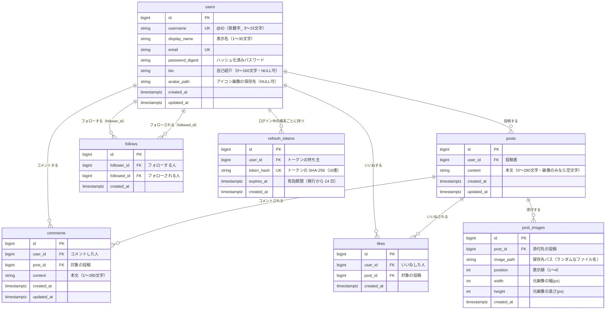

# RaiseTimeline ER図・テーブル定義

## 0. 文書情報

| 項目 | 内容 |
| --- | --- |
| 文書名 | RaiseTimeline ER図・テーブル定義 |
| 版数 | 3.0 |
| 作成日 | 2026-11-14 |
| 最終更新日 | 2026-11-22 |
| ステータス | 作成中 |
| 上位文書 | [要件定義書](01_requirements.md) |
| 関連文書 | [機能一覧](02_features.md)、[機能別要件書](features/)、[技術スタック](05_tech_stack.md) |

本書は、データベースのテーブル構成と、一覧・件数・検索の取得方法を定める。データベース製品は PostgreSQL 16 系（[技術スタック](05_tech_stack.md) 5.）。マイグレーションのファイルの書き方などの詳細は、データ設計書（作成予定）で定める。

### 0.1 変更履歴

| 版数 | 日付 | 変更内容 |
| --- | --- | --- |
| 1.0 | 2026-11-14 | 初版作成（users, posts, comments, likes） |
| 1.1 | 2026-11-14 | follows を MVP の ER図に追加。users.bio を VARCHAR(160) に変更 |
| 1.2 | 2026-11-14 | 本文を VARCHAR(280) に変更。post_images を追加 |
| 2.0 | 2026-11-15 | 文書情報を追加。PostgreSQL 向けに変更（日時を TIMESTAMPTZ、ユーザー名の一意性を大文字と小文字を区別しない式インデックスに）。一覧の続きの取得をキーセット方式に変更。ユーザー検索・おすすめユーザーの SQL と索引の方針（3.5）を追加 |
| 2.1 | 2026-11-22 | users に avatar_path を追加。一覧・プロフィール・検索の SQL でアイコンを取得 |
| 2.2 | 2026-11-22 | DB アクセスを MyBatis に変更したことに合わせ、投稿削除時の画像ファイルの削除を「ORM のコールバック」から「Service の削除処理」に変更 |
| 3.0 | 2026-11-22 | ログイン状態を JWT で持つ方式に変更したことに合わせ、リフレッシュトークンを保存する refresh_tokens を追加 |

## 1. ER図（MVP）



### リレーションの読み方

- **users : posts = 1 : 多** … 1 人のユーザーは複数の投稿を持つ。
- **posts : post_images = 1 : 多（0〜4）** … 1 つの投稿に最大 4 枚の画像が付く。画像ファイル本体はストレージに置き、DB には保存先パスだけを持つ。
- **posts : comments = 1 : 多** … 1 つの投稿に複数のコメント（他ユーザーからも）が付く。
- **users と posts の「いいね」= 多 : 多** … `likes` が中間テーブル。1 人が複数の投稿にいいねでき、1 つの投稿は複数人からいいねされる。
- `comments` も `users` と `posts` をつなぐ中間テーブル的な位置づけだが、本文を持つため独立したエンティティとして扱う。
- **users と users の「フォロー」= 多 : 多（自己参照）** … `follows` が中間テーブル。同じ `users` テーブルを `follower_id`（フォローする人）と `followed_id`（フォローされる人）の 2 本の外部キーで参照する。
  - A さんのフォロー数 = `follower_id = A` の行数
  - A さんのフォロワー数 = `followed_id = A` の行数
- **users : refresh_tokens = 1 : 多** … ログイン状態を保つためのリフレッシュトークン（[auth](features/auth.md) 3.）。ログインするたびに 1 行でき、ブラウザ（端末）ごとに別の行になる。更新すると行を作り直し、ログアウトすると行を削除する。

## 2. テーブル定義

### users（ユーザー）

| カラム | 型 | NULL | デフォルト | 制約 | 説明 |
| --- | --- | --- | --- | --- | --- |
| id | BIGINT | NO | 自動採番（`GENERATED ALWAYS AS IDENTITY`） | PK | |
| username | VARCHAR(15) | NO | | UNIQUE（`lower(username)`） | @ID。入力どおりの大文字・小文字で保存し、一意性は大文字と小文字を区別せずに判定する |
| display_name | VARCHAR(30) | NO | | | 表示名 |
| email | VARCHAR(255) | NO | | UNIQUE | ログイン用。小文字にそろえて保存する |
| password_digest | VARCHAR(255) | NO | | | BCrypt でハッシュ化した値 |
| bio | VARCHAR(160) | YES | NULL | | 自己紹介（0〜160 文字。空文字で保存された場合は NULL に揃える） |
| avatar_path | VARCHAR(255) | YES | NULL | | アイコン画像のストレージ上の保存先（S3 のキー。開発時は `backend/storage/` からの相対パス）。NULL は未設定（画面では頭文字アイコンを表示する） |
| created_at | TIMESTAMPTZ | NO | 現在時刻（`now()`） | | |
| updated_at | TIMESTAMPTZ | NO | 現在時刻（`now()`） | | |

インデックス：**`UNIQUE (lower(username))`**（式インデックス）※ `Hanako` と `hanako` を同じユーザー名として扱う。プロフィールの URL（`/users/:username`）の検索にも使われる、`UNIQUE (email)`

制約：`CHECK (username ~ '^[A-Za-z0-9_]{3,15}$')` ※ユーザー名の形式。アプリ側の検証と二重にかける

> ユーザー検索（F-22）の部分一致は、MVP では索引を付けない（3.5）。

### refresh_tokens（リフレッシュトークン）

| カラム | 型 | NULL | デフォルト | 制約 | 説明 |
| --- | --- | --- | --- | --- | --- |
| id | BIGINT | NO | 自動採番 | PK | |
| user_id | BIGINT | NO | | FK → users.id（ON DELETE CASCADE） | トークンの持ち主 |
| token_hash | CHAR(64) | NO | | UNIQUE | トークンの値の SHA-256（16 進 64 文字）。値そのものは保存しない（DB の中身が漏れてもトークンとして使えないようにする） |
| expires_at | TIMESTAMPTZ | NO | | | 有効期限。発行（更新）から 14 日後 |
| created_at | TIMESTAMPTZ | NO | 現在時刻（`now()`） | | |

インデックス：**`UNIQUE (token_hash)`** ※更新・ログアウトのときにトークンから行を探す、`(user_id)` ※ログイン時に、そのユーザーの期限切れの行を削除する

> アクセストークン（JWT）は DB に保存しない。署名と有効期限（15 分）だけで確かめる。
>
> 更新（`POST /api/auth/refresh`）では、使ったトークンの行を削除して新しい行を作る（同じリフレッシュトークンは 2 回使えない）。期限切れの行は、そのユーザーが次にログインしたときに削除する。

### posts（投稿）

| カラム | 型 | NULL | デフォルト | 制約 | 説明 |
| --- | --- | --- | --- | --- | --- |
| id | BIGINT | NO | 自動採番 | PK | |
| user_id | BIGINT | NO | | FK → users.id（ON DELETE CASCADE） | 投稿者 |
| content | VARCHAR(280) | NO | `''`（空文字） | | 本文。画像のみの投稿は空文字 |
| created_at | TIMESTAMPTZ | NO | 現在時刻（`now()`） | | |
| updated_at | TIMESTAMPTZ | NO | 現在時刻（`now()`） | | |

インデックス：`(created_at DESC, id DESC)` ※タイムラインの並び替えと「さらに読み込む」（3.1）用、`(user_id, created_at DESC, id DESC)` ※フォロー中タイムライン・プロフィールの投稿一覧用

> 「本文か画像のどちらかが必須」は 2 テーブルにまたがる条件のため DB 制約では表現せず、アプリ側のバリデーションで保証する。

> 文字数は「文字」単位で数える（絵文字・日本語も 1 文字）。PostgreSQL の `VARCHAR(280)` は 280 バイトではなく 280 文字（データベースの文字コードは UTF-8）。

### post_images（投稿画像）

| カラム | 型 | NULL | デフォルト | 制約 | 説明 |
| --- | --- | --- | --- | --- | --- |
| id | BIGINT | NO | 自動採番 | PK | |
| post_id | BIGINT | NO | | FK → posts.id（ON DELETE CASCADE） | 添付先の投稿 |
| image_path | VARCHAR(255) | NO | | | ストレージ上の保存先パス（例：`posts/2026/11/3f9a…c1.jpg`）。表示用 URL はアプリ側で組み立てる |
| position | SMALLINT | NO | | 1〜4 | 表示順 |
| width | INT | NO | | | 元画像の幅（px）。詳細画面で縦横比を保って表示するため |
| height | INT | NO | | | 元画像の高さ（px） |
| created_at | TIMESTAMPTZ | NO | 現在時刻（`now()`） | | |

インデックス：**`UNIQUE (post_id, position)`** ※同じ投稿で表示順が重複しないようにする（`post_id` での検索にも使われる）

制約：`CHECK (position BETWEEN 1 AND 4)` ※1 投稿 4 枚まで（枚数チェックはアプリ側でも行う）

> 投稿削除時、DB のレコードは CASCADE で消えるが、**ストレージ上の画像ファイルは自動では消えない**。投稿を削除する Service の処理の中で、画像ファイルも削除すること（MyBatis には削除時に自動で呼ばれる仕組みがないため、明示的に呼ぶ）。
>
> サムネイル（縮小版）はアップロード時に生成し、`image_path` から決まる規則のパス（例：`…c1_thumb.jpg`）に保存する。別カラムは持たない。

### comments（コメント）

| カラム | 型 | NULL | デフォルト | 制約 | 説明 |
| --- | --- | --- | --- | --- | --- |
| id | BIGINT | NO | 自動採番 | PK | |
| user_id | BIGINT | NO | | FK → users.id（ON DELETE CASCADE） | コメントした人 |
| post_id | BIGINT | NO | | FK → posts.id（ON DELETE CASCADE） | 対象の投稿 |
| content | VARCHAR(280) | NO | | | 本文 |
| created_at | TIMESTAMPTZ | NO | 現在時刻（`now()`） | | |
| updated_at | TIMESTAMPTZ | NO | 現在時刻（`now()`） | | |

インデックス：`(post_id, created_at)` ※投稿詳細でのコメント一覧取得用、`(user_id)`

### likes（いいね）

| カラム | 型 | NULL | デフォルト | 制約 | 説明 |
| --- | --- | --- | --- | --- | --- |
| id | BIGINT | NO | 自動採番 | PK | |
| user_id | BIGINT | NO | | FK → users.id（ON DELETE CASCADE） | いいねした人 |
| post_id | BIGINT | NO | | FK → posts.id（ON DELETE CASCADE） | 対象の投稿 |
| created_at | TIMESTAMPTZ | NO | 現在時刻（`now()`） | | |

インデックス：**`UNIQUE (user_id, post_id)`** ※同じ人が同じ投稿に 2 回いいねできないようにする、`(post_id)`

### follows（フォロー）

| カラム | 型 | NULL | デフォルト | 制約 | 説明 |
| --- | --- | --- | --- | --- | --- |
| id | BIGINT | NO | 自動採番 | PK | |
| follower_id | BIGINT | NO | | FK → users.id（ON DELETE CASCADE） | フォローする人 |
| followed_id | BIGINT | NO | | FK → users.id（ON DELETE CASCADE） | フォローされる人 |
| created_at | TIMESTAMPTZ | NO | 現在時刻（`now()`） | | |

インデックス：**`UNIQUE (follower_id, followed_id)`** ※同じ人を 2 回フォローできないようにする（フォロー数の集計・フォロー中タイムラインの取得にも使われる）、`(followed_id)` ※フォロワー数の集計用

制約：`CHECK (follower_id <> followed_id)` ※自分自身をフォローできないようにする（CHECK 制約が使えない DB の場合はアプリ側のバリデーションのみで可）

## 3. 件数・一覧・検索の取得方法

### 3.1 方針

件数は専用カラムを持たず、**集計で求める**のを基本とする（データの二重管理を避け、学習として JOIN / サブクエリを練習できるため。要件定義書 決定事項 No.3）。投稿 1 件ごとに件数を別クエリで取ると N+1 問題になるので、1 ページ分を 1 クエリにまとめて取得する。

一覧の「さらに読み込む」（F-06）は、`OFFSET` ではなく **「最後に表示した投稿より古いもの」を取る方式（キーセット方式）** にする。`OFFSET` だと、読み込みの途中に新しい投稿が増えたときに同じ投稿が 2 回表示されるため（[timeline.md](features/timeline.md) F-06）。並び順を `created_at DESC, id DESC` にし、最後の投稿の `(created_at, id)` を次の要求に渡す。

### 3.2 タイムライン（すべて）

```sql
-- タイムライン 1 ページ分（20件）を、件数と「自分がいいね済みか」付きで取得する例
-- :before_created_at / :before_id は最後に表示した投稿の値。最初のページでは条件ごと外す
SELECT
  p.id,
  p.content,
  p.created_at,
  u.username,
  u.display_name,
  u.avatar_path,
  (SELECT COUNT(*) FROM likes    l WHERE l.post_id = p.id) AS likes_count,
  (SELECT COUNT(*) FROM comments c WHERE c.post_id = p.id) AS comments_count,
  EXISTS (
    SELECT 1 FROM likes l2
    WHERE l2.post_id = p.id AND l2.user_id = :current_user_id
  ) AS liked_by_me
FROM posts p
JOIN users u ON u.id = p.user_id
WHERE (p.created_at, p.id) < (:before_created_at, :before_id)
ORDER BY p.created_at DESC, p.id DESC
LIMIT 20;
```

添付画像は 1 投稿に複数行あるため、上の SQL に JOIN すると投稿の行が増えてしまう。取得した 20 件の投稿 ID でまとめて 1 回だけ取得し、アプリ側で投稿ごとに振り分ける。

```sql
-- 1 ページ分（20件）の投稿の画像を 1 クエリで取得
SELECT post_id, image_path, position, width, height
FROM post_images
WHERE post_id = ANY(:post_ids)
ORDER BY post_id, position;
```

### 3.3 フォロー中タイムライン・プロフィールの投稿一覧

「フォロー中」タブ（F-21）は、3.2 の SQL に「フォローしているユーザー＋自分」の条件を加えるだけで取得できる。

```sql
-- 3.2 の WHERE に次の条件を AND で加える
  AND (
    p.user_id = :current_user_id
    OR p.user_id IN (
      SELECT f.followed_id FROM follows f
      WHERE f.follower_id = :current_user_id
    )
  )
```

プロフィール画面の投稿一覧（F-16）は、加える条件を `p.user_id = :profile_user_id` に変えるだけで同じ形で取得できる。

### 3.4 プロフィールの件数・フォロー状態

```sql
-- プロフィールに表示するユーザー情報と件数、フォローの状態を 1 クエリで取得
SELECT
  u.id,
  u.username,
  u.display_name,
  u.avatar_path,
  u.bio,
  u.created_at,
  (SELECT COUNT(*) FROM posts   p WHERE p.user_id     = u.id) AS posts_count,
  (SELECT COUNT(*) FROM follows f WHERE f.follower_id = u.id) AS following_count,
  (SELECT COUNT(*) FROM follows f WHERE f.followed_id = u.id) AS followers_count,
  EXISTS (
    SELECT 1 FROM follows f2
    WHERE f2.follower_id = :current_user_id AND f2.followed_id = u.id
  ) AS followed_by_me,      -- 自分が相手をフォローしているか（ボタンの表示）
  EXISTS (
    SELECT 1 FROM follows f3
    WHERE f3.follower_id = u.id AND f3.followed_id = :current_user_id
  ) AS follows_me           -- 相手が自分をフォローしているか（「フォローされています」）
FROM users u
WHERE lower(u.username) = lower(:username);
```

### 3.5 ユーザー検索・おすすめユーザー

ユーザー検索（F-22）は、@ユーザー名と表示名を `ILIKE`（大文字と小文字を区別しない LIKE）で部分一致させる。検索語の `\`・`%`・`_` は、アプリ側で前に `\` を付けてエスケープしてから渡す（例：`50%` → `50\%`）。PostgreSQL の LIKE のエスケープ文字は既定で `\`。

```sql
-- :q はエスケープ済みの検索語、:raw_q はエスケープ前の検索語（どちらも先頭の @ と前後の空白は除去済み）
-- 並び順：ユーザー名の完全一致 → 前方一致 → その他、同じ順位はフォロワーの多い順 → 登録の新しい順
SELECT
  u.id,
  u.username,
  u.display_name,
  u.avatar_path,
  u.bio,
  (SELECT COUNT(*) FROM follows f WHERE f.followed_id = u.id) AS followers_count,
  EXISTS (SELECT 1 FROM follows f2
          WHERE f2.follower_id = :current_user_id AND f2.followed_id = u.id) AS followed_by_me,
  EXISTS (SELECT 1 FROM follows f3
          WHERE f3.follower_id = u.id AND f3.followed_id = :current_user_id) AS follows_me
FROM users u
WHERE u.username ILIKE '%' || :q || '%'
   OR u.display_name ILIKE '%' || :q || '%'
ORDER BY
  CASE
    WHEN lower(u.username) = lower(:raw_q)    THEN 0   -- 完全一致（エスケープ前の値で比べる）
    WHEN u.username ILIKE :q || '%'           THEN 1   -- 前方一致
    ELSE 2                                             -- その他の部分一致
  END,
  followers_count DESC,
  u.created_at DESC,
  u.id DESC
LIMIT 20 OFFSET :offset;
```

- 並び順がフォロワー数などで変わるため、検索結果のページングは投稿一覧と違い `OFFSET`（ページ番号）で行う。検索の途中でユーザーが増減して 1 件ずれる程度は許容する。
- `:q` は LIKE 用にエスケープした検索語、`:raw_q` はエスケープ前の検索語。完全一致の判定は LIKE ではなく `=` で行うため、エスケープ前の値を使う。

おすすめユーザー（F-23）は、自分とフォロー済みのユーザーを除き、フォロワーの多い順に 10 人を取る。

```sql
SELECT
  u.id,
  u.username,
  u.display_name,
  u.avatar_path,
  u.bio,
  (SELECT COUNT(*) FROM follows f WHERE f.followed_id = u.id) AS followers_count,
  EXISTS (SELECT 1 FROM follows f3
          WHERE f3.follower_id = u.id AND f3.followed_id = :current_user_id) AS follows_me
FROM users u
WHERE u.id <> :current_user_id
  AND NOT EXISTS (
    SELECT 1 FROM follows f2
    WHERE f2.follower_id = :current_user_id AND f2.followed_id = u.id
  )
ORDER BY followers_count DESC, u.created_at DESC, u.id DESC
LIMIT 10;
```

**検索の索引**

- 部分一致（`'%han%'`）は通常の B-tree 索引が使えないため、MVP では索引を付けず全件を調べる（想定データ量のユーザー 100 人では問題にならない。要件定義書 6.1）。
- ユーザーが増えて遅くなったら、PostgreSQL の拡張機能 `pg_trgm` を有効にし、`username` と `display_name` に GIN 索引（`gin_trgm_ops`）を付ける。`ILIKE '%...%'` でも索引が使われるようになる。

```sql
-- 将来、検索が遅くなったときに追加するマイグレーションの例
CREATE EXTENSION IF NOT EXISTS pg_trgm;
CREATE INDEX idx_users_username_trgm     ON users USING gin (username gin_trgm_ops);
CREATE INDEX idx_users_display_name_trgm ON users USING gin (display_name gin_trgm_ops);
```

### 3.6 発展：カウンターキャッシュ

データ量が増えて集計が重くなった場合は、`posts` に `likes_count` / `comments_count`、`users` に `following_count` / `followers_count`（INT, NOT NULL, DEFAULT 0）を追加し、作成 / 削除時に増減させる方式に切り替える。高速になる代わりに、増減処理の漏れで実データとずれるリスクがある点に注意。
