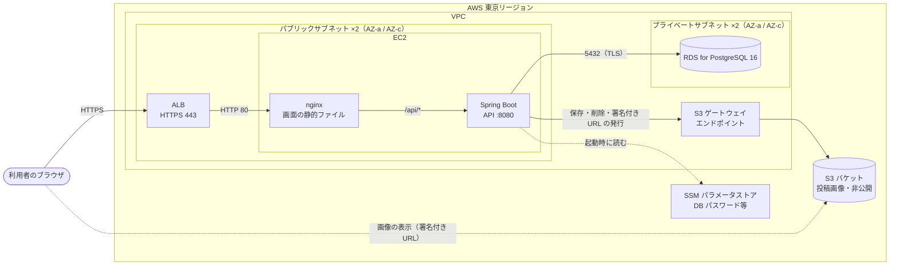

# RaiseTimeline インフラ構成（案）

## 1. 文書情報

| 項目 | 内容 |
| --- | --- |
| 文書名 | RaiseTimeline インフラ構成（案） |
| 版数 | 0.2 |
| 作成日 | 2026-11-15 |
| 最終更新日 | 2026-11-22 |
| ステータス | **案（未確定）** |
| 上位文書 | [要件定義書](01_requirements.md) |
| 関連文書 | [技術スタック](05_tech_stack.md)、[ER図・テーブル定義](04_er_diagram.md) |

本書は、本番環境を AWS 上に構築する場合の構成案を示す。2026-11-15 時点で決まっているのは「投稿画像の保存先に Amazon S3 を使う」ことだけで、**AWS 上にサーバーを構築するかどうかは決まっていない**。構築する場合は「ALB + EC2 + RDS」を想定しているため、その前提で構成図と考え方を先にまとめておく。

構築することが決まったら、本書を「インフラ設計書」として確定させ、先行プロジェクト（TaskManagement・InquiryManagement）と同じく、Terraform の構成・費用の見積もり・デプロイ手順書・デプロイ用のスキルを追加する。

### 1.1 変更履歴

| 版数 | 日付 | 変更内容 |
| --- | --- | --- |
| 0.1 | 2026-11-15 | 初版（案）作成。ALB + EC2 + RDS for PostgreSQL + S3 の構成図、ネットワーク、セキュリティグループ、保留事項を記載 |
| 0.2 | 2026-11-22 | ログイン状態を JWT で持つ方式に変更したことに合わせ、7. No.4 からログイン状態の共有の記述を削除 |

---

## 2. 前提と方針

| No | 前提・方針 | 状態 |
| --- | --- | --- |
| 1 | 投稿画像の保存先は Amazon S3 とする | **決定** |
| 2 | サーバーを構築する場合は、ALB（Application Load Balancer）+ EC2 + RDS の構成とする | 想定（未確定） |
| 3 | リージョンは東京（`ap-northeast-1`）。利用者が日本にいるため。先行プロジェクトと同じ | 想定 |
| 4 | 画面と API は同じドメイン（オリジン）で提供する。ログインの Cookie と CSRF のトークンを扱いやすくし、CORS の設定を不要にするため（[技術スタック](05_tech_stack.md) 4.） | 想定 |
| 5 | DB（RDS）と S3 はインターネットから直接触れない。必ずバックエンドを経由する | 想定 |
| 6 | 費用を抑える。各リソースは無料利用枠の対象と同じ規模（EC2 `t3.micro` / `t4g.micro`、RDS `db.t4g.micro`、ストレージ 20 GB）を上限とする。先行プロジェクトと同じ考え方 | 想定 |
| 7 | すべての AWS リソースはコード（Terraform）で定義し、使わない期間は撤去できるようにする | 想定 |

---

## 3. 構成図

| 構成要素 | 役割 |
| --- | --- |
| ALB | 利用者からの要求をすべて受ける入口。HTTPS で通信し、EC2 へ転送する。EC2 の死活を監視し、異常なら転送を止める。将来 EC2 を 2 台以上にしたときの振り分け役にもなる |
| EC2 | nginx が React の静的ファイル（`npm run build` の結果）を返し、`/api/*` で始まる要求だけを Spring Boot へ転送する。Spring Boot は Docker で動かす案が有力（先行プロジェクトと同じく、ローカルと同じイメージを使えるため） |
| RDS for PostgreSQL | ユーザー・投稿・コメント・いいね・フォロー・画像の保存先パスを保管する。ローカル（Docker の `postgres:16`）と同じ 16 系 |
| S3 | 投稿画像（元画像とサムネイル）を保管する。バケットは非公開にし、表示はバックエンドが発行する署名付き URL（期限つきの URL）で行う |
| S3 ゲートウェイエンドポイント | EC2 から S3 への通信を、インターネットを経由せずに VPC の中で行うための入口。無料 |
| SSM パラメータストア | DB のパスワードなどの秘密情報を暗号化して保管する。EC2 は IAM ロールの権限で読み出す。標準パラメータは無料（TaskManagement と同じ） |

---

## 4. 要求の流れ

| 操作 | 流れ |
| --- | --- |
| 画面を開く | ブラウザ → ALB → nginx（静的ファイルを返す） |
| API を呼ぶ（タイムラインの取得など） | ブラウザ → ALB → nginx → Spring Boot → RDS |
| 画像付きで投稿する | ブラウザ →（`multipart/form-data`）→ ALB → nginx → Spring Boot。Spring Boot が形式・サイズを検証し、EXIF を除去・サムネイルを作成して S3 に保存し、保存先パスを RDS に記録する |
| 画像を表示する | タイムラインの API の応答に、Spring Boot が発行した署名付き URL を含める → ブラウザがその URL で S3 から直接取得する |
| 投稿を削除する | Spring Boot が RDS の行を削除し（コメント・いいね・画像の行は CASCADE で消える）、S3 の画像ファイルも削除する |

---

## 5. ネットワーク

### 5.1 VPC とサブネット

| サブネット | AZ | 置くもの | 理由 |
| --- | --- | --- | --- |
| パブリック a / c | 2 つ | ALB、EC2 | ALB は 2 つ以上の AZ のサブネットが必須。EC2 をパブリックに置くのは、NAT Gateway（月 30 ドル以上かかる）を使わずに OS の更新やコンテナイメージの取得を行うため。EC2 への受信はセキュリティグループで ALB からだけに絞る |
| プライベート a / c | 2 つ | RDS | RDS のサブネットグループは 2 つ以上の AZ が必須。インターネットとの経路を持たせない |

### 5.2 セキュリティグループ

| 対象 | 受信を許可するもの | 備考 |
| --- | --- | --- |
| ALB | インターネット（`0.0.0.0/0`、`::/0`）からの 443（HTTPS）。80 は 443 へ転送するためだけに開ける | 利用者の入口 |
| EC2 | ALB のセキュリティグループからの 80 だけ | SSH の 22 番は開けない。サーバーに入る必要があるときは SSM Session Manager を使う（InquiryManagement と同じ考え方） |
| RDS | EC2 のセキュリティグループからの 5432 だけ | `publicly_accessible = false` |

### 5.3 S3 バケットの設定

- パブリックアクセスをすべて禁止する（ブロックパブリックアクセスを有効）
- EC2 の IAM ロールに、このバケットへの `PutObject` / `GetObject` / `DeleteObject` だけを許可する（`"Resource": "*"` にしない）
- 署名付き URL の有効期限は短く（例：10 分）する。期限が切れたら画面を再読み込みすれば新しい URL が発行される
- バケットの暗号化（SSE-S3）を有効にする（既定で有効）

---

## 6. ローカル環境との対応

| 本番（案） | ローカル | 備考 |
| --- | --- | --- |
| ALB + nginx | Vite の開発サーバー（5173）のプロキシ | どちらも「画面と `/api` を同じオリジンで提供する」役割 |
| EC2 上の Spring Boot | `./gradlew bootRun`（8080） | |
| RDS for PostgreSQL 16 | Docker の `postgres:16`（5432） | 同じ 16 系にそろえる |
| S3 | ディスク（`backend/storage/`） | 保存先は Spring のプロファイルで切り替える（[技術スタック](05_tech_stack.md) 3.） |
| SSM パラメータストア | `application-local.properties` など、コミットしない設定ファイル | パスワードをコミットしない |

---

## 7. 保留事項

| No | 事項 | 選択肢と論点 | 決める時期 |
| --- | --- | --- | --- |
| 1 | **AWS 上にサーバーを構築するか** | 構築しない場合はローカル環境だけで完成とする（S3 は画像の保存先として使うか、ローカルのディスクで代用するかも合わせて決める） | ローカルでの実装が一通り終わったあと |
| 2 | **HTTPS の実現方法（独自ドメイン）** | ALB で HTTPS を使うには ACM（AWS の証明書サービス）の証明書が必要で、証明書には **自分のドメイン** が必要。(a) 独自ドメインを取得して ALB に証明書を付ける（年 1,000〜2,000 円程度）、(b) ALB の前に CloudFront を置き、`*.cloudfront.net` のドメインと証明書を使う（先行プロジェクトと同じ。ドメイン不要）。(b) の場合、CloudFront から ALB への経路を絞る設定が増える | 構築が決まったとき |
| 3 | CloudFront を置くか | No.2 の (b) を選ぶなら置く。置く場合は画像も CloudFront 経由で配信でき、署名付き URL の代わりに CloudFront の署名付き URL / OAC を使う選択肢が生まれる | No.2 と同時 |
| 4 | EC2 の台数・冗長化 | 1 台なら構成が単純で費用も最小。2 台以上にするとデプロイ時の入れ替えの手順が必要になる（ログイン状態は JWT で持ち、サーバーにはセッションが無いため、台数を増やしてもログイン状態の共有は要らない。[技術スタック](05_tech_stack.md) 3.）。費用の方針（2. No.6）から 1 台を第一候補とする | 構築が決まったとき |
| 5 | Spring Boot の動かし方 | (a) Docker で動かす（ローカルと同じイメージ。イメージは ECR に置く）、(b) EC2 に JDK を入れて jar を直接動かす | 構築が決まったとき |
| 6 | IaC（構成のコード化） | Terraform を第一候補とする（先行プロジェクト 2 つと同じ） | 構築が決まったとき |
| 7 | 費用の見積もり | ALB は台数にかかわらず時間あたりの料金がかかるため、先行プロジェクト（CloudFront + EC2 + RDS）より高くなる見込み。EC2・RDS・ALB・パブリック IPv4 アドレスの料金を、構築時点の価格で見積もって本書に記載する。使わない期間は撤去する（2. No.7） | 構築が決まったとき |
